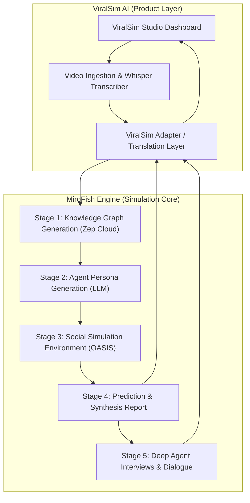

# MiroFish Engine Technical Audit & ViralSim AI Mapping

## 1. Executive Summary

This document details the architectural audit of **MiroFish** (commit `7657031`), its five-stage multi-agent simulation workflow, registered backend endpoints, and how each component directly maps into the **ViralSim AI** product architecture.

---

## 2. MiroFish Architecture & Running State

- **Repository Location**: `C:\Users\hriti\Desktop\MiroFish`
- **Frontend Stack**: Vue 3 + Vite (`http://localhost:3000`)
- **Backend Stack**: Flask + OASIS (`camel-oasis`) + Zep Cloud (`http://localhost:5001`)
- **Python Runtime**: Python 3.12.3 virtual environment (`C:\Users\hriti\Desktop\MiroFish\backend\.venv`)
- **Unit Test Suite**: 129/129 tests passing (`pytest` verified across all modules)



---

## 3. MiroFish 5-Stage Workflow Deep Dive

### Stage 1: Seed Ingestion & Knowledge Graph (`/api/graph/*`)
- **Input**: Document (`.txt`, `.pdf`, `.md`) or raw text context.
- **Ontology Generation**: `POST /api/graph/ontology/generate` analyzes input and produces entity/relation types.
- **Graph Construction**: `POST /api/graph/build` submits chunks to **Zep Cloud** graph batching API (`zep_batch_id`).
- **Graph Polling**: `GET /api/graph/task/<task_id>` polls until entities and edges are materialized.
- **Graph Data**: `GET /api/graph/data/<graph_id>` returns nodes and relationships for visual graph display.

### Stage 2: Agent Persona Generation (`/api/simulation/*`)
- **Entity Extraction**: `GET /api/simulation/entities/<graph_id>` extracts key actors from the graph.
- **Profile Generation**: `POST /api/simulation/generate-profiles` prompts the configured LLM to synthesize social media agent profiles (Twitter or Reddit schemas: username, bio, follower count, sentiment leanings, interest topics).
- **Profile Customization**: `GET /api/simulation/<simulation_id>/profiles` allows inspecting and editing individual agent personas.

### Stage 3: Multi-Agent OASIS Simulation (`/api/simulation/*`)
- **Simulation Prep**: `POST /api/simulation/prepare` initializes the OASIS virtual social network (`camel-oasis`).
- **Simulation Run**: `POST /api/simulation/start` triggers agent turn-based interactions (default 10 rounds).
- **Supported Social Actions**:
  - Twitter mode: `CREATE_POST`, `LIKE_POST`, `REPOST`, `FOLLOW`, `DO_NOTHING`, `QUOTE_POST`.
  - Reddit mode: `CREATE_POST`, `CREATE_COMMENT`, `LIKE_POST`, `DISLIKE_POST`, `LIKE_COMMENT`, `DISLIKE_COMMENT`, `FOLLOW`, `MUTE`.
- **Telemetry Streaming**:
  - `GET /api/simulation/<simulation_id>/run-status/detail`: Live round progress, active agents.
  - `GET /api/simulation/<simulation_id>/timeline`: Sequential post and reaction events.
  - `GET /api/simulation/<simulation_id>/agent-stats`: Activity metrics per agent.

### Stage 4: Prediction Report Generation (`/api/report/*`)
- **Synthesis Agent**: `POST /api/report/generate` launches a specialized analytical agent with reflective tool calling.
- **Tools Used**:
  - `search_graph_tool`: Queries the Zep memory graph for causality and underlying entity links.
  - `get_graph_statistics_tool`: Computes network density, sentiment distributions, and cluster behavior.
- **Output**: Multi-section markdown report structured into:
  1. Executive Summary / Outcome Prediction.
  2. Dynamic Trajectory & Event Milestones.
  3. Persona Group Polarization & Key Influencer Actions.
  4. Strategic Recommendations.

### Stage 5: Agent Interaction & Interviews (`/api/simulation/interview/*`)
- **Individual Interview**: `POST /api/simulation/interview` queries a specific agent with conversational memory of what they posted/liked during the simulation.
- **Batch Interviews**: `POST /api/simulation/interview/batch` asks a question across a subset of personas.
- **Interactive Report Chat**: `POST /api/report/chat` enables talking directly with the Synthesis Report Agent to drill down into specific questions.

---

## 4. ViralSim AI Integration Map

| MiroFish Component | ViralSim AI Role | Adaptation Required |
| :--- | :--- | :--- |
| Document Uploader | Video Uploader & Transcript Pipeline | Convert `.mp4` video transcript + frame descriptions into structured seed markdown |
| General Persona Generator | Social Media Audience Demographics | Bias persona generation by platform (TikTok vs YouTube vs IG Reels) and niche (Tech, Comedy, Finance) |
| OASIS Twitter/Reddit Engine | Video Viewer Behavior Model | Map post/comment actions to video engagement (Watch Through, Rewatch, Drop-off, Share, Comment) |
| General Trend Prediction Report | Video Performance & Virality Audit | Structure output into Hook Effectiveness (0-3s), Retention Analysis, Sentiment Breakdown, and Content Optimization Fixes |
| Agent Interview API | Virtual Focus Group Chat | Enable creators to directly interview simulated viewers: *"Why did you stop watching at 0:15?"* |

---

## 5. Required Environment Configuration

In `C:\Users\hriti\Desktop\MiroFish\.env`:

```env
# LLM API (OpenAI Compatible)
LLM_API_KEY=your_llm_api_key
LLM_BASE_URL=https://api.openai.com/v1
LLM_MODEL_NAME=gpt-4o-mini

# Zep Cloud Graph Memory (Free tier available at https://app.getzep.com/)
ZEP_API_KEY=your_zep_api_key
```

